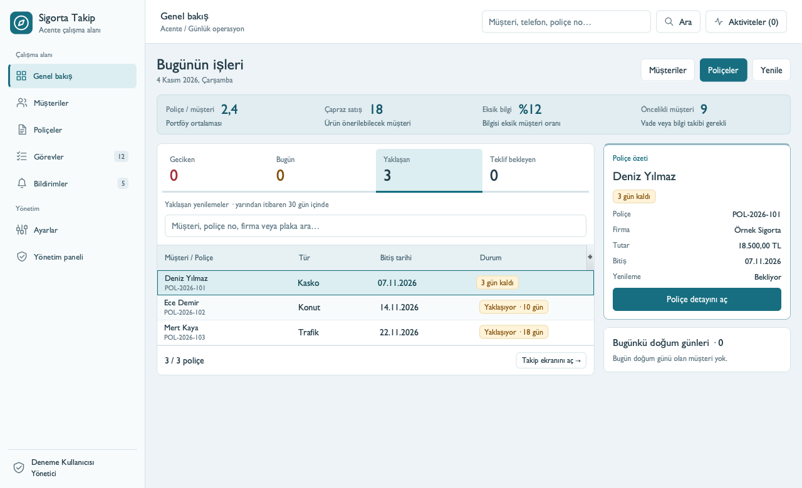
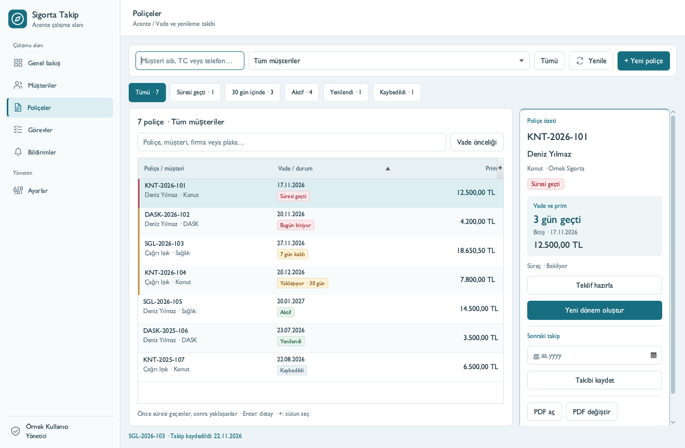
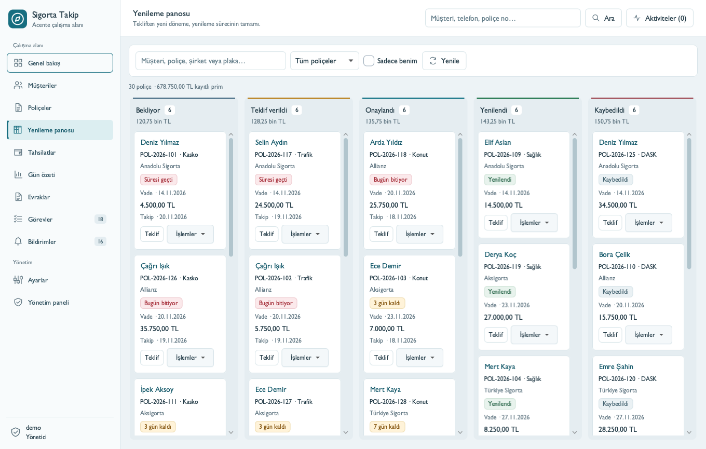
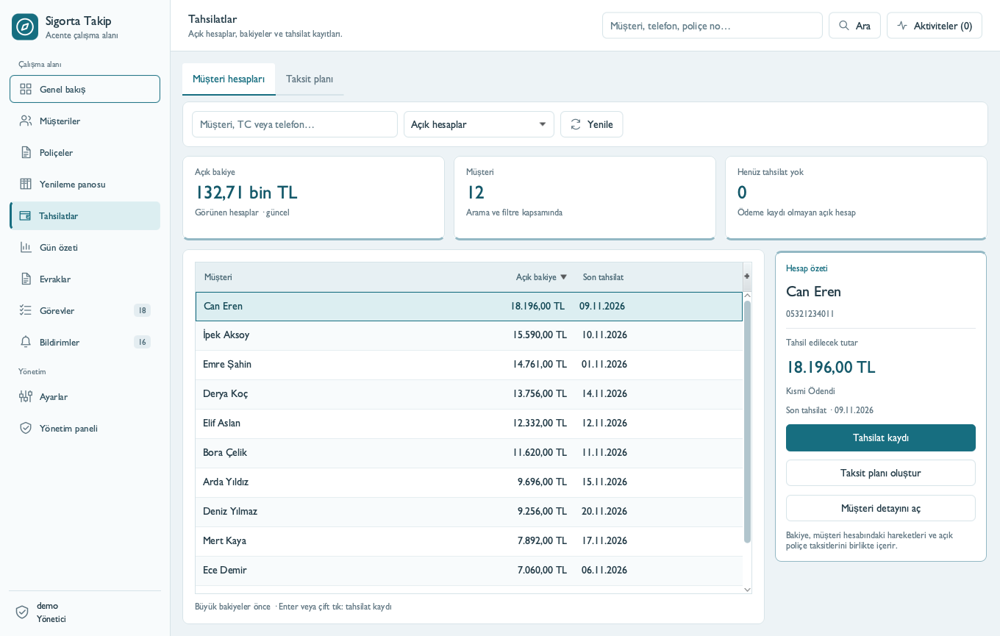

# Insurance Tracker v1.5

Insurance Tracker, sigorta acentelerinin müşteri portföyünü, poliçe vadelerini ve tahsilatlarını takip edebildiği bir masaüstü uygulamasıdır. JavaFX ile çalışır ve kayıtları yerel bir SQLite veritabanında saklar.

## Acentede günlük kullanım

- **Müşteriler ve poliçeler** — Müşteriyi ad, TC veya telefonla bulun. Açık bakiyesini ve poliçelerini inceleyin, poliçeye ait PDF’yi açın veya yeni dönem oluşturun.
- **Yenileme panosu** — Poliçeleri takip aşamasına göre görün. Görüşmeyi kaydedin, teklif hazırlayın ve bir sonraki takip tarihini belirleyin.
- **Tahsilatlar** — Açık hesapları listeleyin, ödeme kaydedin ve kalan borcu taksitlere bölün. Gün özetinden seçili tarihteki tahsilatları inceleyin.
- **Evrak ve aktarım** — Poliçe bazında eksik belgeleri izleyin. Excel dosyalarındaki sütunları eşleştirip değişiklikleri kaydetmeden önce satır bazında inceleyin.

## English overview

Insurance Tracker is a commercial desktop application for insurance agencies. Agents can find a customer’s policies and outstanding balance, record a renewal conversation, schedule a follow-up, and collect payments in instalments. The daily summary brings policy activity and collections together for the selected date. Records are stored locally in SQLite.

## Ekran görüntüleri / Screenshots

Görüntüler örnek kayıtlarla alınmıştır. Tam boy görüntülemek için bir görsele tıklayın.

| Poliçe listesi ve seçili poliçenin ayrıntıları | Yenileme panosu | Açık hesaplar ve tahsilatlar |
| --- | --- | --- |
|  |  |  |

## Lisans ve iletişim / License and contact

Insurance Tracker ticari bir üründür. Kaynak koduna erişim, kullanım ve dağıtım için geliştiricinin yazılı izni gerekir. [Lisans koşulları / License terms](LICENSE)

Demo, iş birliği ve erişim talepleri / Demo, collaboration and access requests: **Uğur Metin Karabulut** · [E-posta](mailto:ugurmetinkarabulut@gmail.com) · [LinkedIn](https://www.linkedin.com/in/uğur-metin-karabulut-a16106340/)
